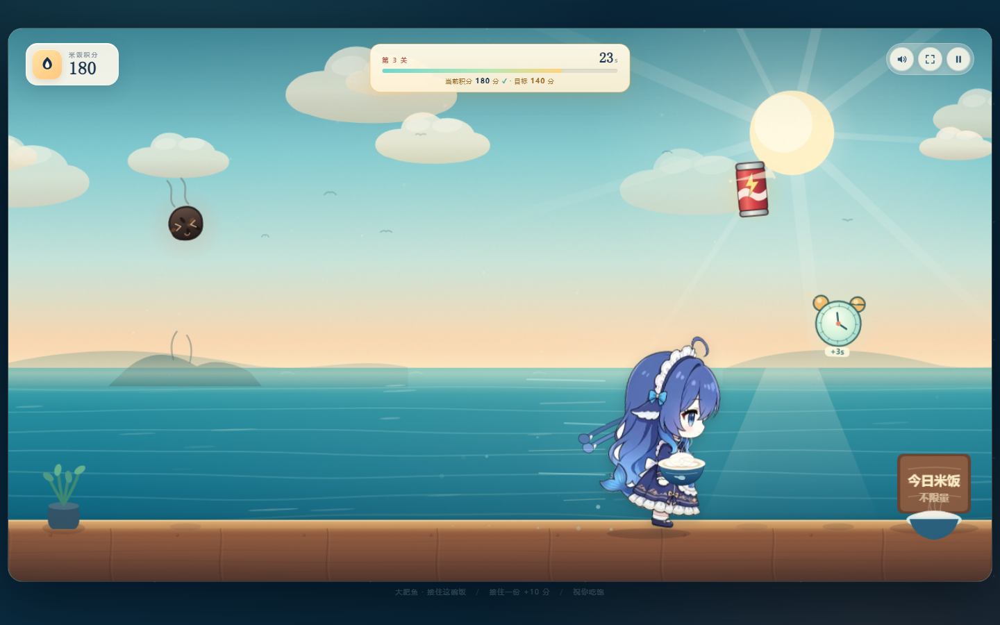
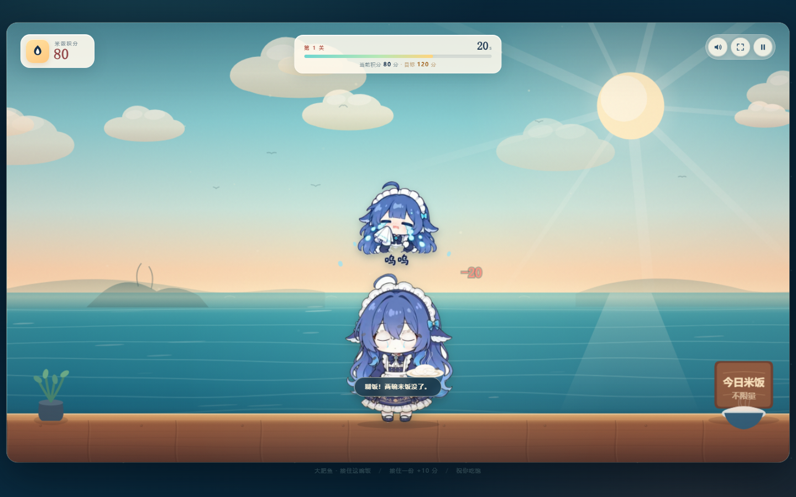
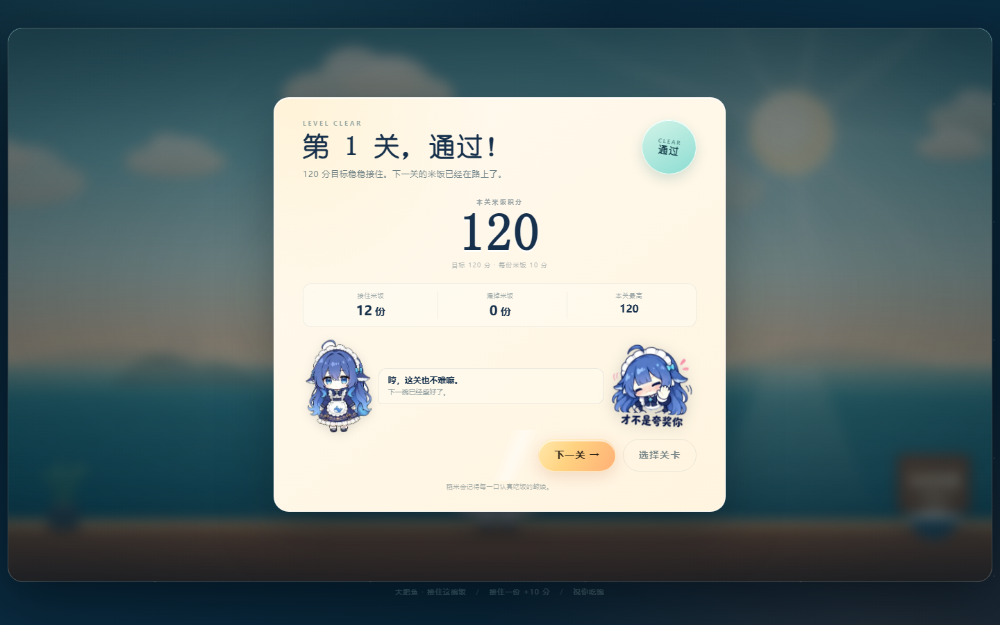

# 大肥鱼 · 接住这碗饭

一个海边食堂主题的 Windows 接米饭小游戏。  
左右移动，接住从天而降的白米饭；躲开糊饭，捡可乐和闹钟，在 30 秒内达到目标分。

> 这是一个**成品发布仓库**：只提供 Windows 可执行游戏和玩法介绍，公开源代码、构建脚本或素材源文件。

## 下载

前往 [Releases](../../releases/latest) 下载：

- `Dafeiyu-Rice-Catch-1.0.0-portable.exe` — 便携版，双击运行，不需要安装
- `Dafeiyu-Rice-Catch-1.0.0-setup.exe` — 安装版，可创建开始菜单和桌面快捷方式

系统要求：Windows 10/11 x64。

## 游戏内容

- 20 个关卡，目标分数从 120 逐步提高到 310
- 白米饭 **+10 分**，糊饭 **-20 分**
- 可乐罐：1.5 秒加速
- 闹钟：游戏时间 **+3 秒**
- 每关 30 秒；达到目标分即可通关，已通关的关卡可以重玩
- 自由模式：60 秒接饭挑战
- 标题页的大肥鱼可以点，随机触发 7 种待机动作
- 原创芯片音乐和 WebAudio 音效，无外部音频依赖

## 操作

| 操作 | 按键 |
| --- | --- |
| 左右移动 | `←` / `→` 或 `A` / `D` |
| 静音 | `M` |
| 全屏 | `F` |
| 暂停 | `Esc` 或 `P` |

## 截图

## 说明

- 当前构建没有代码签名证书，Windows SmartScreen 可能提示「未知发布者」；选择「更多信息 → 仍要运行」即可。
- 游戏进度保存在本机，不会上传到网络。
- 本仓库只发布编译后的游戏，不提供源码、资源文件或构建说明。
- 角色立绘、表情素材和游戏代码版权归项目作者所有。

## 许可

仅允许下载并运行本仓库 Release 中的编译成品，供个人、非商业娱乐使用。  
禁止复制、修改、反编译、再发布、商用或以其他方式利用游戏代码和素材。完整条款见 [LICENSE](LICENSE)。
